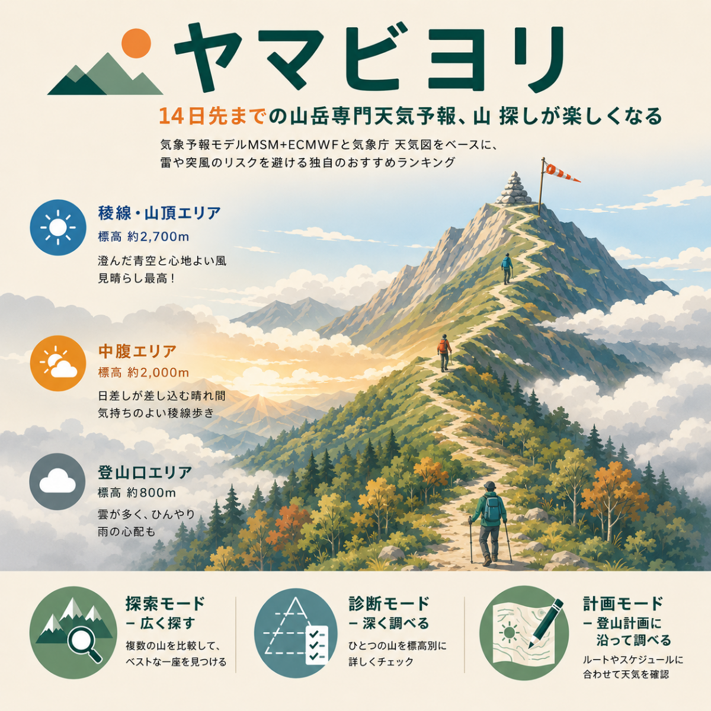
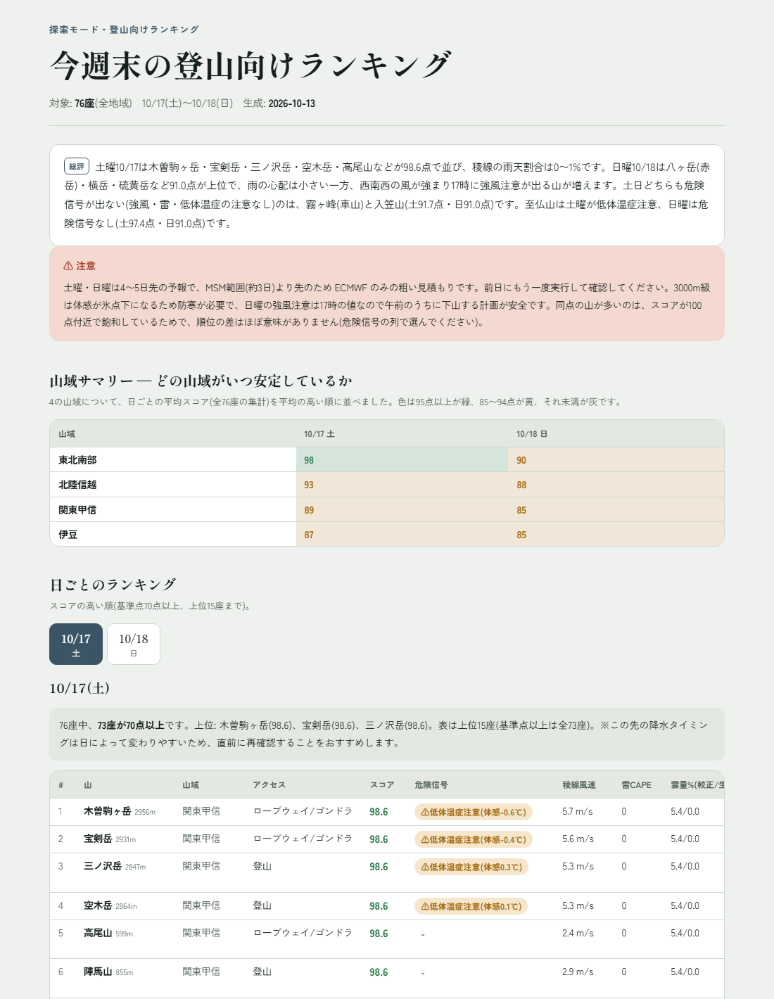
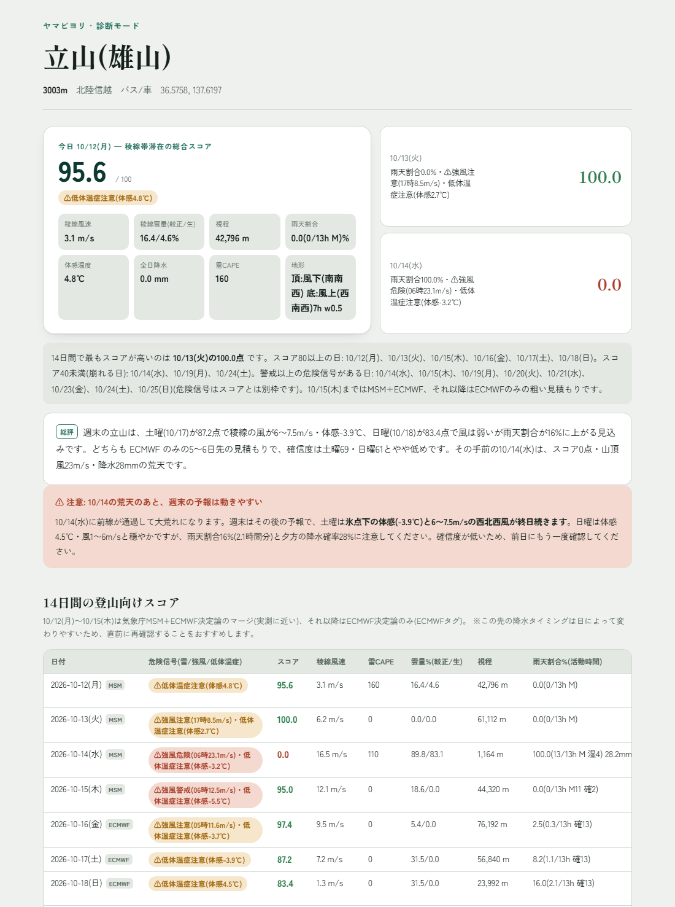
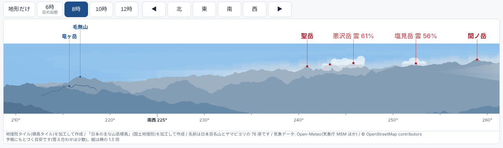
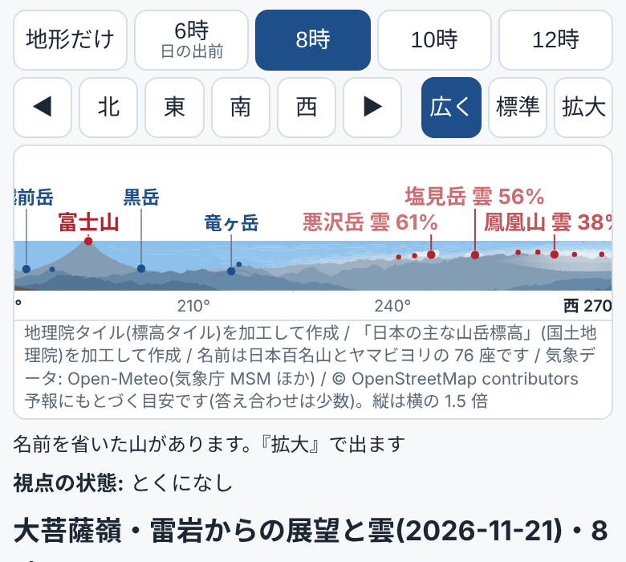
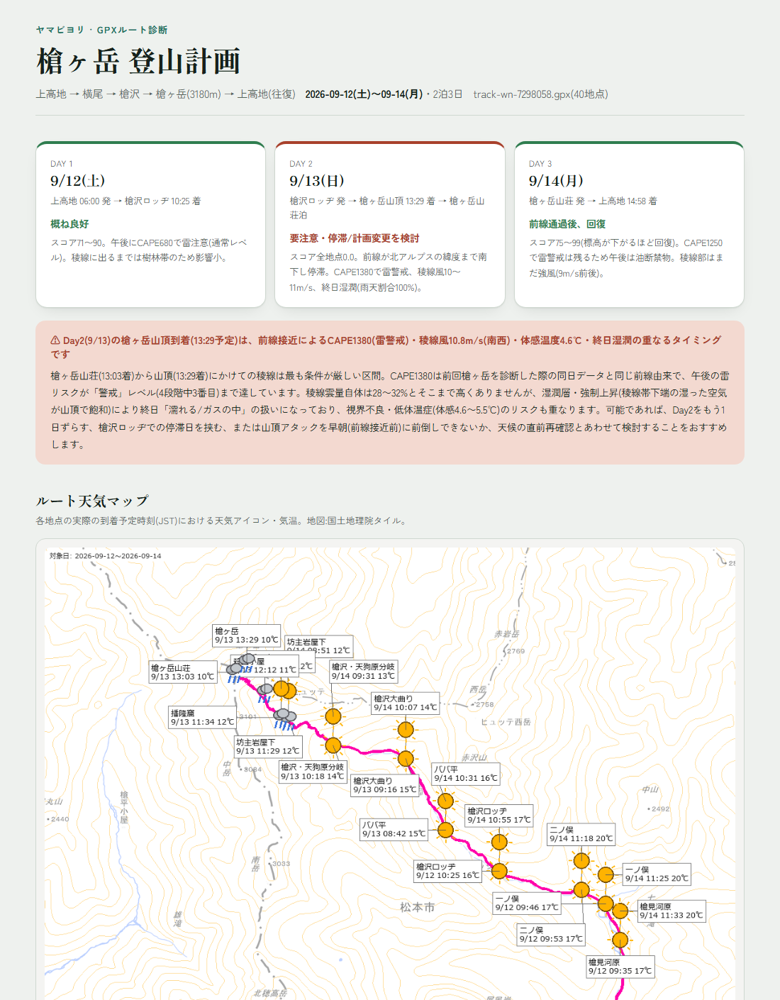

# ヤマビヨリ (Mountain Weather)



[](CHANGELOG.md)
[](LICENSE)
[](requirements.txt)
[](#claude-codeとの連携)

**「その日、その山の稜線は、濡れずに歩けるか」** を数字で答える、登山特化型の天気予報ツール。

Open-Meteoの無料APIだけで動き、気象庁MSM(5km格子・3日先まで)とECMWF IFS(全球・14日先まで)を自動マージ。地上の天気ではなく**山頂標高の空気**を見て、雲量・視程・降水を1本の「登山向け総合スコア」にまとめ、雷・強風・低体温症は別枠の「危険信号」として警告する。関東甲信・北陸信越・東北南部・伊豆の**76座**に対応。診断モードでは、山頂から見える山に翌日の雲を重ねた**展望図**も作れる。

> 一般の天気予報が「甲府市は晴れ」と言う日でも、北岳の稜線は湿った南西風でガスに巻かれていることがある。ヤマビヨリはその差を、気圧面データと山岳気象の基本則(逆転層の蓋・強制上昇・地形の風上風下)で読む。

> **v1.10.0 (2026-11-20) のお知らせ**
> - **天気入りの展望図**: 診断モードに `--panorama` を付けると、山頂から見える山と翌日(`--panorama-date` で別の日)の雲を重ねた図(HTML)ができます
>   ([天気入りの展望図](#天気入りの展望図--panorama))。76座だけ。
> - **山の ID**: 76座に変わらない ID(`m001`〜)を付けました。`--mountain m012` のように ID でも選べ、`--json-out` に `id` が入ります。
> - **14座の座標を直したので、その14座は点数が変わることがあります。** 唐松岳・金峰山・瑞牆山・榛名山・霧ヶ峰・塔ノ岳・赤城山・雲取山・
>   常念岳・安達太良山・男体山・木曽駒ヶ岳・妙高山・八ヶ岳(赤岳)の座標を、国土地理院の山頂の点に直しました。予報を取る地点が変わるため、
>   同じ日でも v1.9.2 と点数が変わることがあります(例: 雲取山は3日間の点数が4〜5点上がり、安達太良山のある1日は0.0→28.6)。
>   ほかの62座の点数と、スコアの計算は変わりません。
>
> 詳細は [CHANGELOG](CHANGELOG.md)。

## 目次

- [ヤマビヨリの特徴](#ヤマビヨリの特徴)
- [3つのモード](#3つのモード)
  - [天気入りの展望図(`--panorama`)](#天気入りの展望図--panorama)
- [スコアの仕組み](#スコアの仕組み)
- [データソース](#データソース)
- [精度と限界(正直なところ)](#精度と限界正直なところ)
- [Codexで試す](#codexで試す)
- [セットアップ](#セットアップ)
- [使い方](#使い方)
- [Claude Codeとの連携](#claude-codeとの連携)
- [ファイル構成](#ファイル構成)
- [更新履歴](#更新履歴)
- [ライセンス](#ライセンス)

## ヤマビヨリの特徴

**1. 山頂標高の値で判断する。**
気圧面(1000〜600hPa)の雲量・湿度・風・気温を、その時刻のジオポテンシャル高度で **1000m / 2000m / 3000m / 各山の山頂標高** へ線形補間する。「850hPa≒1500m」のような固定バンドではなく、燕岳なら2763m、富士山なら3776mの空気をそのまま評価する。

**2. 「濡れるか・ガスに巻かれるか」を山岳気象の基本則で判定する。**
Open-Meteoの降水確率は山では当たりにくい。そこでMSM範囲内は降水量に加えて次の3つの物理ルールで「雨天時間」を数える。

| ルール | 判定 | 背景 |
|---|---|---|
| 湿潤層 | 山頂〜600m下の層でRH≥90%かつ雲量≥40% | 稜線が雲の中=濡れる・ガス |
| 逆転層の蓋 | 山頂400m上が乾いていれば下の湿潤層は数えない | 雲海の日を0点にしない |
| 強制上昇 | 山頂風≥10m/sで、湿った下層(RH≥80%)を持ち上げた凝結高度が山頂以下なら湿潤扱い | 火打山・西穂高岳の実況ミスから導入(v1.3.0) |

**3. 危険信号はスコアに混ぜない。**
雷(CAPE)・稜線の強風・低体温症(風冷+濡れ補正の体感温度)は「平均すると薄まる」性質のものなので、スコアから切り離して**注意 / 警戒 / 危険**の3段階で別枠表示する。スコア100点でも「⚠雷警戒」が付く日がある。

**4. 一要素でも悪ければスコアは落ちる。**
雲量(稜線帯/午後)・視程・降水(活動時間中の雨天割合)を**重み付き幾何平均**で合成。晴れて視程が良くても午後に雨が来る日は高得点にならない。

**5. 活動時間は日の出・日没から決める。**
稜線帯滞在(日の出+1h〜12時)、活動時間(日の出−1h〜日没+30分)を毎日計算。9月と12月で2時間以上ズレる「固定8〜17時」方式を廃止した。

**6. 地形を読む(地理院DEM)。**
国土地理院の標高タイルから76座の山頂まわり16方位の地形を事前計算し、山頂風と稜線帯下端の風の2段で**風上(谷側)/風下(山越え)**と地形性上昇流を表示する(現在は表示のみ、スコア未反映)。

**7. 数値の裏を取る材料も一緒に出す。**
気象庁の実況天気図・予想天気図(+24h/+48h)、ひまわり赤外/雲頂強調画像、ECMWF 51メンバーのアンサンブル確信度、雲海チャンス、天候の変わり目時刻。診断モードではこれらを使って「気圧配置 → 実際の雲 → MSM数値」の順に概況を説明する。

**8. 山頂からの眺めと、翌日の雲を1枚の図で見られる。**
診断モードに `--panorama` を付けると、山頂から見える山(日本百名山と76座の名前付き)に、翌日(`--panorama-date` で別の日も)の6・8・10・12時の雲を重ねた展望図を作る。
「あの山に雲がかかりそうか」を、数字ではなく絵で確かめられる([天気入りの展望図](#天気入りの展望図--panorama))。

**9. 自分で測って、直している。**
予報を実際の観測と1時間ごとに突き合わせるバックテスト基盤
([yamabiyori-backtest](https://github.com/ktakemaru/yamabiyori-backtest))を持ち、その結果を製品に反映している。
山頂雲量の検証は2026年6月12日〜9月17日の98回分の予報(MSM・ECMWF、00Z)を、麓のアメダス日照
(白馬・野辺山・奥日光の3地点で通して。安達太良山/鷲倉は9月11〜18日の8日分のみ)と、
富士山頂自身の日照(7月10日〜8月31日)に当てたもの。
「晴れ/曇りをどれだけ言い当てるか」(AUC、1.0が完璧・0.5が当てずっぽう)は
**1日前(MSM)で0.78、3日前(ECMWF)で0.77、7日前で0.61**。この検証から v1.4〜1.6 で3つを直した:
- **雲量の数字をそのまま信じない。** 予報の「雲量0%」が実際に晴れだったのは約7割、「5%」では約5割だった。
  そこで雲量%を過去の的中率で「晴れる確率」に直してから採点する。遠い日ほど的中率が下がるので、
  遠い日のスコアは自然に控えめになる。
- **MSMの山頂雲量の計算を較正表と揃えた。** 直近1〜2日に使うMSMでは、較正表を作ったデータと本体とで山頂雲量の計算に
  使う気圧面の数が違い(本体は900/800hPaも使う)、標高2,000m前後の山で晴れる確率を低めに見積もっていた。
  本体と同じ計算の山頂雲量で1〜2日目の較正表を作り直した(v1.6.0)。
- **「雨」の閾値を実測で見直した。** 従来の「1時間0.1mm以上=雨」は、実際に測れる雨(0.5mm以上)が
  降った時間の2.6〜4倍を「雨」と言っていた。閾値を引き上げ、霧雨レベルを雨扱いしなくなった。

スコア式の変更は従来どおり、参照日(唐松岳9/6=荒天・立山9/5=快晴・槍ヶ岳9/5)を固定して再計算し、
登山SNSの実況報告と1座1日ずつ突き合わせて確認する。他社予報サイトの答えを覗いて合わせることはしない。

**10. どこまで信じてよいかを明示する。**
検証で分かった限界はそのまま書く(「精度と限界」参照): 信用してよいのは**3日前まで**、
山頂雲量の較正は**6〜9月のデータのみ**、**夜間**と**稜線の風**は実況が無く未検証。スコアはこの範囲で読むこと。

## 3つのモード

### 探索モード — 「今週末、どこがいい?」

`mountain_weather_mvp.py`。76座を横断してスコア順に並べ、70点以上の山だけを今週・来週・2週間先の3期間で一覧する(非対話。v1.5.0 でスコア水準が下がったため目安を80→70に変更)。



<details>
<summary>ターミナル出力の例(テキスト)</summary>

```text
-- 2026-09-19(土) --                                            (v1.5.0の実出力、列を一部省略した抜粋)
順位 山                    危険信号(雷/強風/低体温症)  スコア 稜線風速 雲量%(較正/生) 雨天割合%(活動時間)  体感℃ 地形(山頂風/稜線帯下端風)
1    唐松岳(2696m)         -                           91.8   4.4      28.9/8.1       0.0(0/14h M)          11.3  頂:風下(南) 底:風上(南東)12h w0.7
3    立山(雄山)(3003m)     ⚠雷注意(CAPE580)            84.2   3.3      49.7/14.4      0.0(0/14h M)          7.8   頂:風下(南) 底:並(南東)1h w0.4
4    燕岳(2763m)           ⚠雷注意(CAPE490)            80.7   2.9      57.6/22.3      0.0(0/14h M)          10.7  頂:風下(南) 底:風上(北北東)14h w0.3
15   槍ヶ岳(3180m)         -                           72.4   2.9      72.4/28.4      0.0(0/14h M)          6.9   頂:並(南南東) 底:並(南南東)2h w0.4
```
(v1.6.0 以降は、1〜2日目の数字(スコア・較正後の雲量)が上の例と少し変わりうる。)

</details>

並びはスコアの高い順。**同点(表示の小数1桁が同じ)のときは、危険信号の軽い順(なし→注意→警戒→危険)→ 稜線風速の弱い順 → 山の ID の順**。
晴れの日はほぼ全山が同点になるので、同点が2座以上ある日は表の上に「※ 98.6点が 71 座あります。…」の1行が出る(`--json-out` では日ごとの `tie_note`)。

「雲量%(較正/生)」は左が採点に使う較正後の実効雲量、右が予報そのままの山頂雲量(v1.5.0〜)。雨天割合セルの `M` はMSM降水量で判定した時間帯、`湿n` は湿潤層/強制上昇ルールだけで雨天になった時間数、`確n` はMSM範囲外でECMWF確率の期待値で数えた時間数。**何を根拠に雨天と判定したかが表の中で追える**ようにしてある。

### 診断モード — 「燕岳、この2週間どうか?」

`mountain_weather_detail.py`(山選択)。1座を14日分、日別スコア表と**1時間ごとの標高別テーブル**で深掘りする(対話式)。



<details>
<summary>ターミナル出力の例(テキスト)</summary>

```text
=== 燕岳(2763m) 登山向け総合スコア(日別) ===                       (v1.5.0の実出力、抜粋)
日付            危険信号                                  スコア 雲量%(較正/生) 視程m  雨天割合%(活動時間)     体感℃
2026-09-19(土)  ⚠雷注意(CAPE490)                          80.7   57.6/22.3      39224  0.0(0/14h M)            10.7
2026-09-20(日)  -                                         26.0   90.1/77.6      5280   78.6(11/14h M 湿8) 5.5mm 10.5
2026-09-22(火)  ⚠強風危険(05時14.6m/s)                    75.3   47.5/11.5      40768  21.6(3/14h 確14)        12.3
2026-09-24(木)  ⚠低体温症注意(体感6.0℃)                   46.1   57.7/18.3      16532  67.4(9.4/14h 確14) 4.5mm 6.0

=== 燕岳(2763m) 1時間ごと ===                       (2026-11-15 取得、v1.9.2の実出力。11/17(火)の時刻を抜粋)
日付              時刻   降水確率%(地上) 総雲量%  低層雲%  中層雲%  高層雲%  雲量1000m%   雲量2000m%   雲量3000m%   雲量山頂2763m%  風地上           風1000m          風2000m          風3000m          風山頂2763m         地形風(山頂/稜線帯下端)
2026-11-17(火)    06:00  0               38       6        0        38       0.0          0.0          0.0          0.0             2.1m/s(南西)     0.2m/s(西北西)   6.7m/s(南西)     10.8m/s(西)      9.9m/s(西)          風下 w0.7 / 風下(南西)
                  10:00  0               72       16       0        72       0.0          0.0          0.0          0.0             2.0m/s(南西)     0.2m/s(南南東)   6.6m/s(西南西)   12.4m/s(西南西)  11.1m/s(西南西)     風下 w0.8 / 風下(西南西)
                  13:00  1               32       32       0        0        0.0          7.4          0.8          2.6             2.0m/s(南西)     0.5m/s(南東)     5.2m/s(南西)     13.6m/s(西南西)  11.6m/s(西南西)     風下 w0.9 / 風下(南西)
                  16:00  4               97       61       31       94       0.0          9.2          1.0          3.2             1.2m/s(東南東)   0.5m/s(東南東)   4.3m/s(南西)     12.4m/s(南西)    10.5m/s(南西)       風下 w0.8 / 風下(南西)

=== 燕岳(2763m) 天候の変わり目 ===
2026-09-23(水): ※09:00頃を境に降水確率が悪化する見込み(それまで平均2% → それ以降平均60%)。早めの行動開始・早め下山で回避できる可能性があります。

=== 燕岳(2763m) ECMWFアンサンブル確信度(51メンバー) ===
日付            予報  確信度  雲量/降水/気温内訳
2026-09-22(火)  晴れ  63      55/60/73
2026-09-25(金)  晴れ  76      72/77/79
2026-09-27(日)  雨    52      37/61/60
```
(日別スコア表・天候の変わり目・確信度は v1.5.0 の出力。v1.6.0 以降は、1〜2日目の数字(スコア・較正後の雲量)が上の例と少し変わりうる。)
(1時間ごとの表は 2026-11-15 に取り直した v1.9.2 の出力。「総雲量%」は地上付近の雲量ではなく空全体の雲量で、その内訳が低層雲%・中層雲%・高層雲%。この日は山頂と1000〜3000mの雲量が0〜9%なのに、朝(6〜10時)の総雲量は38〜72%で、その中身はほぼ高層雲(低層雲は6〜16%)。16時は総雲量97%(低層雲61%・高層雲94%)。山頂は濡れないが、空は高い雲で白くなる予報と読む。)

</details>

このほか雲海・快晴チャンス(日の出前後に稜線が晴れて下層に雲がある時刻)、MSM範囲内の日は気象庁天気図・ひまわり画像つきの概況説明を出す。

#### 天気入りの展望図(`--panorama`)

山頂に立ったときに**どの山が見えて、翌日(日付を指定すればその日)の朝〜昼にどこに雲がかかりそうか**を、1枚の図で見られる。
診断モードに `--panorama` を付けるだけで、診断のあとに図(HTML)ができ、最後に「展望図: <パス>」と出る。76座だけ。





大菩薩嶺・雷岩から(2026-11-21 8時の予報で作った図)

```powershell
./venv/Scripts/python.exe -X utf8 mountain_weather_detail.py --mountain 大菩薩嶺 --panorama
```

- できた HTML をブラウザで開く。時刻のボタン(6・8・10・12時)で雲が替わる。スマートフォンでは縮尺(広く・標準・拡大)・◀▶・指でなぞる、で見る。
- 名前が出るのは日本百名山とヤマビヨリの76座。名前が重なる所では、点だけにして名前を省く(スマートフォンでは「拡大」で出る。パソコンでは点にマウスを当てると出る)。
- **時間は手元の標高タイルの枚数で変わる**(1枚も無ければ約14分、近くの山の図を作ったあとなら数分、保存がそろっていれば約20秒)。
  作る前に `--panorama-estimate` で見積もれる(通信しない):
  ```powershell
  ./venv/Scripts/python.exe -X utf8 mountain_weather_detail.py --mountain 大菩薩嶺 --panorama-estimate
  ```
- 予報にもとづく目安で、写真との答え合わせは少数([精度と限界](#展望図について))。

##### くわしい動き

- **保存先**: `out/panorama/<山の ID>.html`(外の読み込みのない HTML 1枚)。`--panorama-out ファイル` で場所を変えられる
  (例: `--mountain m008 --panorama --panorama-out out/koma.html`)。山頂から 300m 以内に OpenStreetMap の展望地があれば、
  展望地の図 `<ID>v.html` も作る。
- **日付(`--panorama-date YYYY-MM-DD`)**: 省くと翌日。今日から予報の最終日(14 日分)までの日を指定できる(過去・範囲の外・形の違う日付は断って終了コード 2)。
  日付を指定したときのファイル名は `out/panorama/<ID>_<日付>.html`(展望地の図は `<ID>v_<日付>.html`)。
  `--panorama-estimate` と一緒に使うと、その日の予報の保存の有無で見積もる(例: `--mountain m026 --panorama --panorama-date 2026-11-26`)。
- **HTMLレポートに入れる**: `scripts/render_report.py` に `--panorama-html out/panorama/<ID>.html`(展望地の図があれば
  `--panorama-viewpoint-html out/panorama/<ID>v.html` も)を渡すと、総評のすぐあとに図が1枚入る(展望地の図があればそちら。
  手順は `skills/yamabiyori/references/report_style.md`)。図は iframe を使わずレポートのページに直接入る。レポートは 1 枚でおよそ 0.85MB 大きくなる。
- **初回は時間がかかる**: その山のまわり(半径 200km)の国土地理院の標高タイル約 560 枚を、1 枚ごとに 1 秒あけて取る(**約 12 分**・ディスク
  **約 300MB**、`terrain_cache/`。2026-11-20 に大菩薩嶺で空のフォルダから測った値: 566 枚・12 分 14 秒・286MB。タイルのあとの予報 155 回と
  図づくりは 109 秒で、全体は約 14 分)。図の地形の計算は 1 座 15〜50 秒(`cache/panorama/parts/` に保存し、2 回目からは使い回す)。
  予報は 1 座 約 110〜170 回(Open-Meteo。通信の間隔は自動で調整。`cache/panorama/weather/`、3 時間で取り直す)。
  2 回目以降(保存済み)は 1 座 約 20 秒。
- **時間の見積もり(`--panorama-estimate`)**: 山頂の図に要る標高タイルを数え(ズーム11・14ごとに、要る・手元・足りない枚数)、
  足りない枚数 × 1 枚 約 1.3 秒(上の実測 566 枚・12 分 14 秒)+ 予報と図づくり(地形の計算と予報が保存済みなら約 20 秒、
  地形の計算だけ保存済みなら約 50 秒(2026-11-24、高尾山の実測 49.3 秒)、地形の計算の保存が無ければ 190 秒(2026-11-24、高尾山の実測。地形の計算 99.8 秒を含む。
  2026-11-20 の大菩薩嶺は 109 秒))を出す。予報の取得・図の作成はせず、終了コード 0 で終わる。
  展望地の図は調べるのに通信が要るので入れていない。見積もりだけなので、`--panorama`・`--json-out`・`--panorama-out` を一緒に付けても図も JSON も書かない
  (`--out` を付けると見積もりの文をファイルに保存する)。76 座に無い山は `--panorama` と同じく「展望図は 76 座だけです」。
- **進み具合**: 標高タイルを取っているあいだ、50 枚ごと(または 60 秒ごと)に「標高タイル 100 / 566 枚(残り 約 10 分)」を標準エラーに出す。
  探索・診断の始まりの「○ 座の予報を取ります」も標準エラー。標準出力(診断・ランキングの文)は変わらない。
- **山名**: 日本百名山とヤマビヨリの 76 座の名前は、はじめから出る(山頂の点は `panorama/data/summits.json`。国土地理院
  「日本の主な山岳標高」のうち、百名山と 76 座に当たる点だけを抜き出したもの)。図に「名前は日本百名山とヤマビヨリの 76 座です」と書く。
  そのほかの山の名前も出したいときは、「日本の主な山岳標高」(1003 山)の表(GeoJSON)を `cache/panorama/gsi_1003/` に置く
  (表は自動では取らない。ブラウザで [国土地理院のページ](https://www.gsi.go.jp/kihonjohochousa/kihonjohochousa41139.html) から取得して展開する)。
  76 座のうち表に点の無い 11 座は `MOUNTAINS` の座標を山頂の点にし、その山の図に「山頂の点は目安です」と書く。
- **名前の置き方**: 「広く」「標準」では重ならずに置ける名前だけを出す(百名山 → 76 座 → そのほかの順。近い山から。富士山は見えれば必ず出す)。
  置けない山は点だけで、図の下に「名前を省いた山があります。『拡大』で出ます」。「拡大」では見えている百名山と 76 座を全部出す
  (横向きの画面では幅に 20° を守り、高さを超える分はページを縦に送る)。幅 900px 以上の画面(パソコン)も「標準」と同じ決まりで、
  置けない山は点だけ(点にマウスを当てると名前)。画面の高さがとても小さいときは、図を縮めすぎず(本来の 0.6 倍まで)、ページを縦に送る。
- **山頂の雲量**(名前の横の「雲 NN%」・名前のうすさ・山にかかる丸い雲): 山頂をはさむ 2 つの気圧面の雲量のうち大きいほう
  (展望図の中だけ。診断の文・`--json-out` の雲量は今までどおり)。
- **失敗しても診断は止めない**: 展望図が作れないときは、診断の出力はそのままで、最後に「展望図は作れませんでした(理由)」の 1 行。
  予報が取れないときは「地形だけ」の図、展望地が調べられないときは山頂の図だけ。
- 出典(図の枠の中に出す): 地理院タイル(標高タイル)を加工して作成 /「日本の主な山岳標高」(国土地理院)を加工して作成 /
  気象データ: Open-Meteo(気象庁 MSM ほか)/ © OpenStreetMap contributors(展望地の図だけ)。

### GPXルート診断 — 「この計画書のルートで、どの地点が危ないか?」

`mountain_weather_detail.py`(GPXモード)。ヤマレコの登山計画書GPXから登山口・山小屋・山頂などの地点を自動抽出し、**地点ごとの標高に補間した値**で天気を評価する。オプションで天気アイコン付きのルート地図PNGも生成できる。



## スコアの仕組み

```
登山向け総合スコア = 幾何平均( 雲量(稜線帯/PM) ^0.25 × 視程 ^0.25 × 降水(雨天割合) ^0.50 )
危険信号(スコア外)  = 雷(CAPE) / 稜線の強風(日中ピーク) / 低体温症(体感温度)  → 注意・警戒・危険
```

| 軸 | 何を見るか | 山頂標高の値? |
|---|---|---|
| 雲量 | 毎時の山頂雲量を実況晴れ率で較正した「実効雲量」(v1.5.0〜、遠い日ほど辛い。v1.6.0 から基準値は較正表の行ごとに持ち、MSMの1〜2日目は本体と同じ7面の山頂雲量で学習した行)の、稜線帯滞在時間の平均と午後(12時〜日没)の連続2時間平均の最大値の悪い方 | ○ |
| 視程 | 稜線帯滞在時間の平均(広域モデル値) | − |
| 降水 | 活動時間中の「雨天時間の割合」+ 活動時間内の合計降水量(20mmで満点ペナルティ) | ○(湿潤層・強制上昇) |
| 雷 | ECMWF CAPEの活動時間内ピーク | − |
| 強風 | 山頂風速の日中ピーク | ○ |
| 低体温症 | 山頂の気温 − 風冷 − 濡れ補正(−3℃) | ○ |

MSM範囲内(今日〜+2日)は上記の物理ルールで時間単位に判定し、それより先はECMWF降水確率の期待値でならす(4日目以降の時間別詳細は意図的に追わない)。式と定数はすべて `mountain_weather_core.py` に集約され、変更理由は [CHANGELOG.md](CHANGELOG.md) に日付つきで残している。

## データソース

| データ | 提供元 | 用途 |
|---|---|---|
| 気象庁MSM(`jma_msm`、5km格子、〜3日先) | Open-Meteo | 気圧面の雲量・RH・風・気温・降水量(近距離・高精度) |
| ECMWF IFS 0.25°(〜14日先) | Open-Meteo | 4日目以降の予報、降水確率、CAPE |
| ECMWF ENS(51メンバー) | Open-Meteo | アンサンブル確信度(診断モード) |
| 実況・予想天気図 | 気象庁 | 診断モードの概況説明(オプション、Playwright) |
| ひまわり赤外/雲頂強調画像 | 気象庁 | 「今まさに雲があるか」の裏取り(オプション、Pillow) |
| 標高タイル(DEM) | 国土地理院 | 地形レイヤー(風上/風下・地形性上昇流) |
| 日本の主な山岳標高(1003山、2026-03-31版) | 国土地理院 | 14座の山頂の座標(`MOUNTAINS` の lat・lon。2026-11-18 に直した山)、展望図の百名山と 76 座の山頂の点・山名(`panorama/data/summits.json`。百名山と 76 座に当たる点を抜き出し呼び名を付けた)、そのほかの山名(利用者の手元の表) |
| 展望地(tourism=viewpoint) | © OpenStreetMap contributors(ODbL) | 展望図の視点(山頂から 300m 以内。利用者の手元で Overpass から取る) |

すべて無料・APIキー不要。レスポンスは `cache/` に3時間TTLでキャッシュされ、76座の再計算は数秒で終わる。

## 精度と限界(正直なところ)

### バックテストで測ったこと(詳細は [yamabiyori-backtest](https://github.com/ktakemaru/yamabiyori-backtest))

山頂雲量の検証は、2026年6月12日〜9月17日のMSM・ECMWF予報98回分(00Z)を、
麓のアメダス日照(白馬・野辺山・奥日光の3地点で通して。安達太良山/鷲倉は9月11〜18日の8日分のみ)と、
富士山頂自身の日照(7月10日〜8月31日、774時間)に1時間ごとに当てたもの。
全層の雲量(総雲量 `cloudcover`)については2025年9月18日〜2026年9月17日の1年分の予報を保存しており、
観測の揃う約5か月分(2026年1月15日〜2月28日、6月11日〜9月18日)で別途確認した。
寒候期(1〜2月の45日分)は暖候期より0.04〜0.06低い傾向が見えているが、標本が少なく(n=1,483)確定していない。

| 何日前の予報か | 担当モデル | 晴れ/曇りの言い当て(AUC) | 富士山頂の実況で見ると | 読み方 |
|---|---|---|---|---|
| 1日前 | MSM | 0.78 | 0.75 | よく当たる |
| 3日前 | ECMWF (MSMは0.71) | 0.77 | 0.76 | 信用してよい範囲 |
| 5日前 | ECMWF | 0.71 | 0.64 | 傾向として読む |
| 7日前 | ECMWF | 0.61 | 0.56 | ほぼ気候値。「その週は良さそう」程度 |
| 10日前 | ECMWF | 0.55 | 0.55 | 当てずっぽうと大差ない |

(AUCは1.0が完璧、0.5が当てずっぽう。左の列は麓の日照で測った値、右は富士山頂自身の日照で測った値で、
登山者が山頂で体験する精度は右に近い。)

- 直近3日はMSM(5km格子)、それより先はECMWF(25km格子)。**3日前までは山頂の値として信用してよく、
  7日先以降は雲量スコアの差にほとんど意味が無い。** 14日表示は「傾向」として読む。
- 雲量の数字は「順序」は正しいが「大きさ」は雲量%ではなかった(0%でも晴れは約7割)。v1.5.0 で
  過去の的中率にもとづく確率に直してから採点している。v1.6.0 で、MSM の1〜2日目の較正を本体と同じ
  山頂雲量の作り方(900/800hPa を含む補間)で学び直した。
- 降水「あり」の閾値は実測で見直した(v1.4.0)。それでも1時間単位の雨のタイミングは、当日でも空振り・見逃しが残る。

### 検証できていないこと
- **山頂雲量の較正は6〜9月の日中のデータで作っている。冬は、山頂に雲がかかる予報の日のスコアが低めに出る可能性がある。**
  冬(10〜5月)にも同じ表を使っていて、短いリード(1〜2日目相当)での暫定検証では、山頂に雲がかかる予報の時間
  (較正後の晴れ確率0.12以下)でも麓では13〜43%の時間が晴れていた。晴れ予報の日は影響を受けない。麓の日照で確かめているため、
  山頂だけ雲の中という冬型の日にどこまで当てはまるかは未確認。積雪期・残雪期は未対応。
- **冬の3日目以降の較正は未検証。** 冬の検証は短いリード(1〜2日目相当)についての暫定的なものだけで、冬の3日目以降について
  較正が良いか悪いかは確かめていない。次の冬(2026-27)のデータで再評価する。
- **MSMの3〜4日目は旧式の較正のまま。** 取得日から3〜4日目のMSMの時間(1回の予報あたり平均29時間)は、較正表の入力
  (山頂雲量の作り方)が本体と違う旧版のまま(900/800hPaを使わずに学習)。2027年3月に作り直す予定。
- **夜間**(夜明け前の雲海・星空)は実況が日照のため検証できていない。ひまわり画像での検証は未着手。
- **稜線の風**は実況が存在しない(富士山も2004年に風の観測を終了)。風の数値は他サービスとほぼ一致するが、精度の裏付けは無い。
- 3000m級の山頂そのものの実況は富士山1点(7月10日〜8月31日)。3000m級での較正の妥当性は暫定
  (槍ヶ岳9/5のように、実況は晴れなのに較正で66点まで下がる参照例がある)。
- 濡れ補正(−3℃固定)・視程閾値は未検証。

### 他サービス比較・登山記録との照合で分かっていること

他サービス(てんきとくらす・Windy・SCW・Mountain-Forecast・WeatherNews)との比較と、登山SNSの実況報告との突き合わせから。

**一致しているところ**
- 標高を揃えて比べると、雲量・気温・風速は他サービスとほぼ一致する(山頂気温は1℃前後、山頂風速は0.5m/s程度の差)。
- 2026-09-12の実況照合(11座・11日分)では、**8座がタイミング・性質とも一致**、1座が軽微な立ち上がり遅れ、2座が大きなミスマッチだった(照合前に大きく外れていた火打山9/6・西穂高岳9/10は強制上昇ルールで改善)。
- 雲海(下の層は曇り・稜線は快晴)の構造検出は複数回、実況で裏付けられている。

**まだ弱いところ**
- 2〜3日先の**降水ピークがどの日か**の精度は他サービスと同程度で、モデル自体の不確実性が支配的。
- 稜線高度の飽和が終日続く予報が外れて正午に晴れ間が出るケース(谷川岳9/10型)は、同じ入力からは直せない。衛星画像との同時刻突き合わせが次の候補。
- 雲量軸は「山頂の空気の飽和度(ガスの代理指標)」であって「空がどれだけ雲に覆われるか」ではない(Open-Meteoの気圧面雲量はRHからの近似値)。展望の予想には、時間ごとの表の総雲量%(空全体の雲量。地上付近の雲量ではない)と、その内訳の低層雲%・中層雲%・高層雲%の方が適切。総雲量が高くても低層雲が低ければ、山の上に高い雲が広がっているだけで雲海ではない(2026-11-14 大菩薩嶺)。
- 槍ヶ岳のような狭い岩峰のガスは、5km格子より小さい現象なので拾えない。
- **積雪期・残雪期は未対応**(無雪期の登山を前提に設計)。
- 濡れ補正(−3℃固定)や視程閾値は未検証。

### 展望図について
- **雲は予報にもとづく目安。** 写真との答え合わせは、写真14枚(写った山はのべ42座)ぶんと少ない。
- **かすみ(視程)・木・予報の格子より細かい雲は、図に入らない。**
- **パソコンの幅(900px 以上)では、名前を省く山がある**(名前どうしが重ならないようにするため)。省いた山は点だけで、点にマウスを当てると名前が出る。
- **日本百名山と76座以外の山の名前は出ない**(国土地理院「日本の主な山岳標高」の表を自分で `cache/panorama/gsi_1003/` に置いたときだけ、
  ほかの山の名前も出る)。

検証の記録は `skills/yamabiyori/SKILL.md` の「未検証・今後の課題」と「既知の精度傾向」に1座ずつ、
バックテストの結果は [yamabiyori-backtest](https://github.com/ktakemaru/yamabiyori-backtest) の `docs/` に残している。

## Codexで試す

ChatGPTアプリのCodexで、コマンドを自分で打たずに試せます。事前に、Git と Python 3.10以上を入れておいてください(Python は [python.org](https://www.python.org/downloads/) のインストーラーで、最初の画面の「Add python.exe to PATH」にチェックを入れる。入れ忘れると `python` と打ったときに Microsoft Store が開く)。
ChatGPT の無料枠でも試せるよう、Codex が読む量と試行回数を少なくする構成にしている。

1. Windows PCにChatGPTアプリをインストールして、サインインする。
2. Codexに切り替えて、「ファイル → フォルダを開く → 新しいフォルダ」で、`yamabiyori` フォルダ(プロジェクト)を作る。
3. チャット欄で、Codexに次のように指示する。

```text
https://github.com/ktakemaru/yamabiyori.git をこのフォルダに clone して、AGENTS.md の手順どおりにセットアップし、軽量実行(--limit 3)で動作確認してください。
```

途中でネットワーク(pip や天気データの取得)の許可を求められたら、許可する。
天気データの取得に失敗したときは、たいてい Open-Meteo 側の一時的な問題なので、時間をおいてやり直す。

Codex は [AGENTS.md](AGENTS.md)(セットアップ・成功条件・変更してよい範囲)に従います。CLI・IDE拡張や macOS でも使えます(CLI ならフォルダに移動して `codex` を起動)。

うまく動いたら、たとえば次のような改造も頼める:

```text
探索モードを、東京から近い山だけで実行できるようにしてください。
スコアの計算には触れず、山の選び方だけを変えてください。
```

## セットアップ

以下は Windows PowerShell 表記。macOS/Linux では `./venv/Scripts/python.exe` を `./venv/bin/python`、
最初の `python` を `python3` に読み替える。

```powershell
python -m venv venv
./venv/Scripts/python.exe -m pip install -r requirements.txt
./venv/Scripts/python.exe -X utf8 scripts/check_setup.py     # セットアップ確認([NG] があれば案内に従う)
```

**実行するときは `-X utf8` を付ける。** Windows の Python 3.14 以前では、付けずに出力をパイプで受けると
`⚠` などの記号で `UnicodeEncodeError` になることがある(本体のスクリプトは付け忘れても UTF-8 で出力するようにしてある)。
Windows PowerShell 5.1 で `>` を使うと文字化けするので、出力をファイルに残すときは `--out ファイル名` を使う。

必須の依存は `requests` と `numpy`(地形レイヤー)のみ。以下のオプション機能を使う場合は `requirements.txt` のコメントに従って追加インストールする。

| 機能 | 追加パッケージ |
|---|---|
| 気象庁天気図の取得(診断モードの概況説明) | `playwright` + `playwright install chromium` |
| ルート天気マップPNG、ひまわり画像 | `Pillow` |

## 使い方

```powershell
# 探索モード: 全山ランキング(非対話。初回は数分かかる。Open-Meteo の利用上限を避けるため通信の間隔を自動で調整し、最後に「実行時間の内訳」を1行出す)
./venv/Scripts/python.exe -X utf8 mountain_weather_mvp.py
./venv/Scripts/python.exe -X utf8 mountain_weather_mvp.py --limit 3        # 動作確認用: 先頭3座だけ
./venv/Scripts/python.exe -X utf8 mountain_weather_mvp.py --region 伊豆     # 地域で絞る(複数回指定可)
./venv/Scripts/python.exe -X utf8 mountain_weather_mvp.py --out out/ranking.txt  # 結果をUTF-8でファイルに保存(out/ はgitignore済み)

# 診断モード: 対話的に山を選択(1=山選択 / 2=GPXルート診断)
./venv/Scripts/python.exe -X utf8 mountain_weather_detail.py

# 診断モード: 非対話(番号はリスト順なので --list で確認。山名の一部でも可)
./venv/Scripts/python.exe -X utf8 mountain_weather_detail.py --list
./venv/Scripts/python.exe -X utf8 mountain_weather_detail.py --mountain 富士山
./venv/Scripts/python.exe -X utf8 mountain_weather_detail.py --mountain m012   # 山の変わらない ID でも選べる(ID は --json-out の JSON にある)

# 診断モード + 天気入りの展望図(76座だけ。時間は --panorama-estimate で先に見積もれる。上の「天気入りの展望図」)
./venv/Scripts/python.exe -X utf8 mountain_weather_detail.py --mountain 大菩薩嶺 --panorama-estimate
./venv/Scripts/python.exe -X utf8 mountain_weather_detail.py --mountain 大菩薩嶺 --panorama

# 診断モード: 76座に無い山(山名・緯度・経度・標高を4つ一緒に指定。地形データなしで診断する)
./venv/Scripts/python.exe -X utf8 mountain_weather_detail.py --name 栗駒山 --lat 38.9609 --lon 140.7884 --elevation 1626

# HTMLレポート: 数値をJSONで保存 → 解説を足して変換(手順は skills/yamabiyori/references/report_style.md)
./venv/Scripts/python.exe -X utf8 mountain_weather_detail.py --mountain 富士山 --json-out out/fuji.json
./venv/Scripts/python.exe -X utf8 scripts/render_report.py --data out/fuji.json --out out/fuji.html
# 探索モードのレポートのランキングは、既定で1つの表(「行ける山」と「見送る山」(危険信号が警戒以上)の2つの表に分けるには --ranking-layout split)
./venv/Scripts/python.exe -X utf8 scripts/render_report.py --data out/explore.json --out out/explore.html --ranking-layout split
# --json-out の JSON には、各山の変わらない ID(`id`: m001〜。並べ替えても変わらない)が入る。76座に無い山(--name)は null

# テスト(オフライン)
./venv/Scripts/python.exe -X utf8 -m unittest
```

Claude Code・Codex から使うときは、30 秒以上かかる作業の前に、何をするかと時間の目安が 1 行で先に伝えられる
(目安の表と出どころは [AGENTS.md](AGENTS.md) の「長い作業の前に伝える」。測っていない作業は「まだ測っていません」と言う)。

探索モードの主な調整パラメータ(`mountain_weather_mvp.py` 冒頭): `REGION_FILTER`(空=全地域)、`TOP_N_PER_DAY`、`MIN_SCORE_THRESHOLD`(既定70点。v1.5.0で80から変更)。

## Claude Codeとの連携

このリポジトリはClaude Codeプラグインとして構成されている(`.claude-plugin/plugin.json`)。インストールすると `skills/yamabiyori/SKILL.md` が読み込まれ、「富士山の天気は?」「今週末どこかいい山ない?」「このGPXのルートを診断して」のような質問に、Claude Codeがこのツールを実行して答える。診断モードでは天気図・衛星画像を読んだ概況説明つきで、探索モードではランキングをHTMLの一覧にまとめて返す使い方を想定している。

```bash
# このリポジトリをプライベートマーケットプレイスとして追加してインストール
claude plugin marketplace add https://github.com/ktakemaru/yamabiyori
/plugin install yamabiyori@yamabiyori-marketplace

# ローカルで動作確認だけしたい場合(マーケットプレイス登録不要)
claude --plugin-dir .
```

## ファイル構成

| パス | 役割 |
|---|---|
| `mountain_weather_core.py` | 共有基盤。山リスト(76座)、気圧面→標高補間、湿潤層/強制上昇ルール、スコア式、Open-Meteoキャッシュ、ひまわり画像取得。単体では実行しない |
| `mountain_weather_mvp.py` | 探索モード本体 |
| `mountain_weather_detail.py` | 診断モード(山選択・GPXルート診断)本体。天気図取得・ルート地図PNG・アンサンブル確信度もここ |
| `mountain_terrain.py` / `precompute_terrain.py` / `terrain_profiles.json` | 地形レイヤー。地理院DEMから76座分を事前計算済み(`terrain_cache/` はタイルキャッシュ、自動生成) |
| `panorama/` | 天気入りの展望図(`--panorama`)。地形・山名・雲・図(HTML)の部品。`panorama/data/` に山名の辞書と、百名山・76座の山頂の点(`summits.json`) |
| `tools/build_panorama_summits.py` | `panorama/data/summits.json` を作り直すスクリプト(国土地理院「日本の主な山岳標高」の表が手元にあるときだけ動く) |
| `time_estimates.py` | 時間の目安(実測の値)と、作業の始まりに標準エラーへ出す1行 |
| `cli_output.py` | `--out`(出力を UTF-8 BOM付きでファイルに保存)の共通処理 |
| `tests/`, `scripts/check_setup.py` | オフラインのテスト(参照3日の回帰チェックは `tests/fixtures/refs/` のフィクスチャで動く)とセットアップ確認 |
| `AGENTS.md` | Codex などのコーディングエージェント向けの指示(セットアップ・成功条件・変更してよい範囲) |
| `CLAUDE.md` | Claude Code 向けの指示。`AGENTS.md` を取り込み、Claude 固有のルール(記録・確認の運用)だけを足している |
| `.github/workflows/ci.yml` | CI。オフラインのテストとセットアップ確認を Windows/Ubuntu × Python 3.10/最新安定版で実行(Open-Meteo 実通信の smoke は手動実行のみ) |
| `scratch_past_date.py` / `scratch_validate_refs.py` | 検証ツール。過去日付の再計算(実況照合用)と、参照3日の回帰チェック |
| `skills/yamabiyori/SKILL.md` | 設計ドキュメント本体。スコア式の根拠、各機能の設計判断、既知の落とし穴、検証記録 |
| `skills/yamabiyori/references/weather_map_reading.md` | 天気図読解の手引き(概況説明用) |
| `skills/yamabiyori/references/report_style.md` / `recommend_guide.md` | HTMLレポートの作り方(手順・必須要素)と、山・山域をすすめるときの指針 |
| `scripts/render_report.py` / `report_baseline.py` / `fetch_synoptic.py` | HTMLレポートの生成(数値JSON+解説 → 自己完結HTML)と、気象庁の天気図・ひまわり画像の取得。`--json-out` は診断・探索モード共通 |
| `.claude-plugin/plugin.json`, `marketplace.json` | Claude Codeプラグインのマニフェストとプライベートマーケットプレイス定義 |
| `CHANGELOG.md` | 仕様・スコア式の変更履歴(日付・内容・理由) |
| `cache/`, `screenshots/`, `maps/` | 実行時に自動生成(Open-Meteoレスポンス・展望図の予報と部品、天気図・衛星画像、ルート地図PNG)。gitignore済み |
| `out/` | 結果の保存先(`--out` のファイル、HTMLレポート、展望図 `out/panorama/`)。gitignore済み |
| `terrain_cache/` | 国土地理院の標高タイルのキャッシュ(地形レイヤーと展望図で共用。展望図は1座 約300MB)。自動生成、gitignore済み |

## 更新履歴

詳細は [CHANGELOG.md](CHANGELOG.md)。

- **v1.10.2 (2026-11-24)** — 長い作業の前に時間の目安を1行で伝える決まりを書き、展望図の時間を手元の保存の状態から見積もる `--panorama-estimate` を足した(標高タイルの取得中は進み具合も出る)。探索モードの同点の並びを、危険信号の軽い順 → 稜線の風が弱い順に決めた。レポートでおすすめの山が日ごとのランキングにも必ず出るようにし(★ の印・順位の列)、ランキングを2つの表に分ける `--ranking-layout split` を足した(既定は1つの表)。地形の列の風向が実行ごとに変わることがあった不具合を直した。スコア・危険信号の判定・予報の数字は変更なし。
- **v1.10.1 (2026-11-22)** — 診断のレポート(`scripts/render_report.py`)に展望図を1枚入れられるようにした(`--panorama-html`・`--panorama-viewpoint-html`。iframe を使わずページに直接入れる)。展望図の HTML を約半分の大きさに軽くした(図の見た目は同じ)。引数を付けないときのレポート・スコアは変更なし。
- **v1.10.0 (2026-11-20)** — 診断モードに `--panorama` を足し、山頂から見た翌日の雲を重ねた展望図(HTML)を作れるようにした(76 座だけ。初回は標高タイルの取得に約 14 分)。山に変わらない ID(`m001`〜)を付けた。Open-Meteo の利用上限(429)を種類で分けて扱い、探索モードの通信の間隔を調整するようにした。14 座の座標を国土地理院の山頂の点に直した(この 14 座は同じ日でも v1.9.2 と点数が変わることがある)。
- **v1.9.2 (2026-11-15)** — 診断モードの時間ごとの表で、列名「雲量地上%」を「総雲量%」に改めた(中身は地上付近ではなく空全体の雲量)。低層雲%・中層雲%・高層雲%の列を足し、高い雲だけの朝に雲海・快晴チャンスが出ないよう、判定を低層雲で行うようにした。スコアの計算は変更なし。
- **v1.9.1 (2026-11-11)** — Open-Meteo への通信で、1つの接続を使い回すようにした(GitHub Actions などで新しい接続が途中で止まり、取得に失敗する山が出ていたため)。URL・時間切れ・再試行・キャッシュ、予報の数字は変更なし。
- **v1.9.0 (2026-10-14)** — 診断モードに、76座に無い山・地点を診断する引数 `--name`・`--lat`・`--lon`・`--elevation` を追加(座標・標高を指定。地形データなし)。README の3モードの節にレポート画像を追加。既定の動作・スコアの計算は変更なし。
- **v1.8.0 (2026-10-14)** — 診断・探索モードの結果を解説つきHTMLにするレポート出力(`--json-out`・`scripts/render_report.py`)を追加。山をすすめる指針、日付指定・時間別表・おすすめ表も追加。既定の動作・スコアの計算は変更なし。
- **v1.7.0 (2026-09-24)** — Codex などのエージェントや初めての人が迷わず動かせるように、実行まわりを整備(スコアの計算は変更なし)。探索モードに `--limit`/`--region`、診断モードに `--list`/`--mountain`(非対話)、両方に `--out`(UTF-8でファイル保存)を追加。セットアップ確認 `scripts/check_setup.py`、オフラインのテスト、CI、README「Codexで試す」、AGENTS.md の再構成。Windows で文字コードのエラー(cp932)で止まらないようにした。
- **v1.6.1 (2026-09-24)** — 文書のみ(コードの変更なし)。冒頭のお知らせ・「精度と限界」・スコアの仕組みの表・出力例の注記・SKILL.mdの説明を v1.6.0 の変更に合わせて更新。
- **v1.6.0 (2026-09-23)** — MSM(直近1〜2日)の山頂雲量の較正を、本体と同じ山頂雲量の作り方(900/800hPaを含む補間)で学び直した(バックテスト R12)。1〜2日目のスコアが平均+1.0点動く(5点以上動くのは11%、3日目以降は変化なし)。既知の制約を「精度と限界」に追記。
  (v1.9.2 まで冒頭に載せていたお知らせ: 較正表を作ったときと本体とで MSM の山頂雲量の計算方法(使う気圧面の数)が違い、晴れる確率を
  低めに見積もっていたのを揃えた。日ごとの上位の顔ぶれはほぼ変わらない。「行ける」の目安 70点は v1.5.0 から変わらない。)
- **v1.5.0 (2026-09-19)** — 山頂雲量を過去の的中率で「晴れる確率」に直してから採点する(バックテストの較正テーブル)。スコア水準が下がったため「行ける」の目安を80→70点に変更。
- **v1.4.0 (2026-09-19)** — 「雨」の閾値を実測で見直し(MSM 0.1→0.5mm/h、アンサンブル 0.1→0.2mm/h)。霧雨レベルを雨扱いしなくなり、小雨の日のスコアが上がる。
- **v1.3.0 (2026-09-12)** — 実況照合11座の結果から「強制上昇ルール」を雨天判定に追加(強風で湿った下層が持ち上がり山頂で飽和する状況を検出)。検証ツールの計算式を本番と一致させた。
- **v1.2.0 (2026-09-11)** — 標高別の値を気圧面の線形補間に再設計(1000/2000/3000m+山頂)、逆転層の蓋判定、地理院DEMの地形レイヤー、雨天判定をMSM降水量+湿潤層ベースに統一、天気図・ひまわり画像つき概況説明、12座の座標修正。
- **v1.1.0 (2026-09-08)** — スコアを重み付き幾何平均に再設計し、雷・強風・低体温症を「危険信号」として分離。降水を活動時間中の雨天割合ベースに変更。棒ノ折山を追加(76座)。
- **v1.0.0 (2026-09-05)** — 初版(探索モード・診断モード・GPXルート診断)。

## ライセンス

[MIT License](LICENSE) — 無償・自由に利用・改変・再配布してよい。ただし本ツールが取得するOpen-Meteo・気象庁(MSM/天気図/ひまわり)・国土地理院(地理院タイル)のデータ自体は各提供元の利用規約に従うこと(詳細はSKILL.md参照)。
